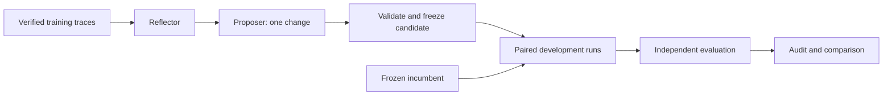

# ReflexForge

**Can a coding agent learn a better debugging workflow from its own failures?**

ReflexForge is a research framework for testing that question. An OpenAI-powered worker
repairs code in a Docker sandbox. A Reflector examines permitted training traces, a
Proposer suggests one configuration change, and an independent evaluator measures whether
the resulting candidate performs better under the same execution limits.

The unit of improvement is a **versioned prompt, workflow, or skill**. Model weights stay
fixed. Every experiment retains the evidence needed to inspect what changed, what the
worker actually did, and whether the submitted code passed independent checks.

**Current status:** real worker runs and end-to-end meta-optimization pilots have completed.
The latest candidate has **not demonstrated a task-success improvement**. Exploratory
candidates have not been promoted to the active configuration.

## How it works



1. **Worker:** inspects source, reproduces a failure, edits allowlisted files, and runs
   visible tests through a bounded tool loop.
2. **Reflector:** separates the original defect, worker actions, final patch evidence,
   final observations, and uncertainty. Its citations must match the supplied trace evidence.
3. **Proposer:** produces exactly one generalizable configuration change. Candidate
   validation rejects changes to execution parameters or tool permissions.
4. **Comparison:** runs the incumbent and candidate on the same development tasks with
   identical model settings, tools, budgets, task snapshots, and Docker image.
5. **Independent evaluator:** applies approved source changes to a fresh fixture and runs
   protected checks. Worker summaries and visible-test results do not determine success.

The exploratory pilot cannot promote a candidate. The separate strict Gatekeeper checks
complete paired evidence, regressions, resource use, and task-level statistical evidence.
Its default significance threshold requires at least five improved distinct tasks with no
negative tasks. RepoBench has four development tasks, so this suite supports exploratory
comparison rather than satisfying that promotion requirement by itself.

## What is implemented

- Official OpenAI Python SDK with the Responses API, explicit function-call IDs, and
  multi-turn tool-result handling.
- Seven worker tools: `list_dir`, `read_file`, `search_code`, `edit_file`, `run_shell`,
  `run_tests`, and `read_skill`.
- Disposable Docker workers and fresh evaluation containers, with bounded commands,
  output, memory, process count, and execution time.
- Reuse of recorded real training failures with split, model, configuration, benchmark,
  and provenance checks; original records remain intact.
- Stage-aware failure attribution and literal evidence validation. Insufficient evidence
  requires uncertainty; rejected reflections never reach the Proposer.
- Raw Reflector response capture before parsing or validation, with owner-only diagnostic
  artifacts, hashes, validation errors, and spending accounting.
- Isolated configuration snapshots, content hashes, Git-backed accepted-version history,
  and rollback support.
- Durable shared API-call, token, and USD reservations; ambiguous usage stops further calls.
- SQLite metadata, JSONL traces, patches, independent outcomes, and paired comparison reports.

## Quickstart

Requires **Python 3.11+**. Actual worker execution also requires Docker with Linux containers
and an OpenAI API key. Run these commands from the repository root.

### Install and inspect without model calls

```bash
python3.11 -m venv .venv
source .venv/bin/activate
python -m pip install -e '.[dev,analysis]'

reflexforge --help
reflexforge list-tasks
reflexforge run-worker --task task_001 --dry-run
```

A worker dry run records a synthetic plan. It does not call OpenAI, start Docker, run an
independent evaluation, or manufacture repair outcomes.

For the recorded development dependency versions, use `requirements-dev.lock.txt` followed
by `python -m pip install --no-deps -e .`. That file is an environment snapshot, not a
cross-platform lockfile with verified package hashes.

### Configure credentials and Docker

Create a repository-root `.env` using your editor:

```dotenv
OPENAI_API_KEY=your-key-here
OPENAI_MODEL=gpt-5.4-mini
OPENAI_META_MODEL=gpt-5.4-mini
REFLEXFORGE_IMAGE=reflexforge-sandbox:local
```

The application loads this file before reading settings, regardless of the current working
directory. Explicit environment variables take precedence. `.env` is ignored by Git;
credentials are not passed to task containers.

```bash
docker build -t reflexforge-sandbox:local -f src/reflexforge/sandbox/Dockerfile .
reflexforge doctor
```

`doctor` checks local configuration, key presence, Docker connectivity, and image
availability. It makes no OpenAI request unless you add `--api`, which retrieves model
metadata without generating a response.

### Run one real debugging task

**This command makes paid OpenAI requests:**

```bash
reflexforge run-worker --task task_001
reflexforge report
```

The command exits nonzero if independent evaluation does not pass. Standalone workers use
per-run task/configuration limits; use the benchmark or meta-pilot commands when you need
a shared USD and API-call cap across an experiment.

## Benchmarks and spending controls

| Suite | Tasks | Train / dev / test | Purpose |
|---|---:|---|---|
| `debug` | 38 | 18 / 12 / 8 | Compact debugging fixtures |
| `repobench` | 12 | 6 / 4 / 2 | Repository-level debugging across 7–8 source modules |

Both suites are **project-authored fixtures**. ReflexForge's RepoBench is a local suite;
these results are not SWE-bench scores or results on an external benchmark with the same
name. Some original `debug` tasks have recorded prior agent exposure.

For USD enforcement, set input/output prices in USD per million tokens for the selected
model. The values below are the pricing assumptions used in the recorded experiments;
check the rates applicable to your account before another paid run.

```bash
export REFLEXFORGE_INPUT_PRICE=0.75
export REFLEXFORGE_OUTPUT_PRICE=4.5
export REFLEXFORGE_META_INPUT_PRICE=0.75
export REFLEXFORGE_META_OUTPUT_PRICE=4.5

# Offline preflight: no model requests or benchmark evaluation.
reflexforge benchmark preflight \
  --suite repobench --split train --tasks task_101 \
  --conditions static --attempts 1 \
  --max-tokens 24000 --max-api-calls 40 --max-usd 0.15
```

To execute that single-task experiment, replace `benchmark preflight` with `benchmark run`.
**`benchmark run` starts paid execution immediately; it has no `--execute` switch.**
Inspect its returned experiment ID with:

```bash
reflexforge benchmark report --suite repobench --experiment EXPERIMENT_ID
```

Real benchmark execution requires existing fixture-QA receipts matching the selected task
hashes and image. `benchmark validate --suite repobench` generates QA through Docker
without LLM calls, but executes fixture/evaluator code and is separate from an offline
preflight. Pin `--bank-version` and `REFLEXFORGE_IMAGE` to reproduce a recorded experiment.

RepoBench benchmark runs use 24,000 tokens, 20 steps, 240 seconds, 30 seconds per command,
and zero retries per worker. The controller applies the stricter task/configuration
limits. Global caps remain configurable and are enforced before generation. Calls include
input-token counting; token totals include cumulative input across turns, not just output.

Preflight reports reservation bounds, not a spending forecast or a completion guarantee.
Allow enough global capacity for **both** conditions before beginning a pair. A resource
stop is recorded separately from code correctness; a token-limited patch can still pass
independent evaluation. Uncertain usage blocks subsequent requests.

## Run a meta-optimization pilot

Reuse verified **training** failures without paying to regenerate the training workers:

```bash
# Preflight only; substitute run IDs from your own recorded training runs.
reflexforge meta-pilot \
  --run-ids TRAIN_RUN_ID_1,TRAIN_RUN_ID_2 \
  --dev-tasks DEVELOPMENT_TASK_ID \
  --max-tokens 200000 --max-api-calls 200 --max-usd 0.50
```

Add **`--execute`** only when ready to authorize paid execution. A pilot attempts one
Reflector generation, one Proposer generation, and an isolated candidate comparison.
Validation or budget failures stop the pipeline; they do not trigger automatic paid retries.
One ledger covers the meta stages and worker evaluations.

To evaluate an existing candidate without generating another proposal:

```bash
# Paid execution. Use frozen snapshot directories, not the active configuration.
reflexforge benchmark run \
  --suite repobench --split dev --tasks DEVELOPMENT_TASK_IDS \
  --conditions static,candidate --attempts 1 \
  --config PATH_TO_FROZEN_INCUMBENT \
  --candidate-config PATH_TO_FROZEN_CANDIDATE \
  --max-tokens 200000 --max-api-calls 200 --max-usd 0.50

reflexforge benchmark compare --suite repobench --experiment EXPERIMENT_ID
```

Read the [pilot guide](docs/meta-pilot.md) before execution. Development outcomes,
private evaluator events, reference fixes, and held-out test data must never become
Reflector or Proposer training inputs. Held-out evaluation requires an explicit `--final`.

## Measured results

**Local experiment snapshot: November 9, 2026.** These are recorded real OpenAI runs,
not mocked outcomes or fixture-QA scores.

The completed attribution-v2 pilot proposed one workflow addition:

> After the last edit, rerun the visible tests before stopping and record the result.

The frozen candidate was then evaluated on two additional development repositories.

| Development task | Incumbent independent checks | Candidate independent checks | Full-task result |
|---|---:|---:|---|
| task_108 — original pilot | 3/5 | 4/5 | Both failed |
| task_109 — subsequent comparison | 4/5 | 4/5 | Both failed |
| task_110 — subsequent comparison | 5/5 | 5/5 | Both passed |

Both configurations solved **1/3 tasks**. Every worker in these three pairs already ran
visible tests after its final edit. The additional instruction therefore showed no
incremental final-test compliance or full-task success benefit in these observations.
Passing more individual checks on task_108 did not constitute solving the task.

On the two fresh tasks, the candidate used 44,408 tokens versus the incumbent's 46,082
(3.6% fewer), and 28 versus 30 tool calls, but took 75.64 versus 64.16 seconds. The whole
four-run experiment used 90,490 tokens and 121 API calls, with a ledger USD upper estimate
of $0.07719. These small, single-attempt comparisons do not establish statistical improvement.
No candidate was promoted.

Recorded identifiers:

- Attribution-v2 pilot: `bfbf9707d90942d9a193a0eff8bd4b2f`
- task_108 experiment: `a2ddb96e56e84f8f84da5d5f45bec36e`
- task_109/task_110 experiment: `e6ceb4bc2c4c4525ba52dbd9e2310f05`

Artifacts are local and Git-ignored, so these IDs identify this checkout's records rather
than a publicly downloadable result bundle. Earlier task_107 comparisons used different
candidates and are not pooled into this candidate's results. All four RepoBench development
tasks now have recorded worker exposure; none should be described as fresh for a later study.

## Evidence, isolation, and limitations

Workers execute as a non-root user with networking disabled, a read-only root filesystem,
dropped capabilities, no host workspace mount or Docker socket, and bounded writable
filesystems. A trusted controller stages fixtures and evaluator files. Evaluation starts
from the original repository plus approved source changes; worker-edited visible tests
are not carried into independent evaluation. See [security](docs/security.md) for the
threat model and limitations of Docker isolation.

Task snapshots, hashes, image IDs, model settings, budgets, patches, and outcomes support
reconstruction of the recorded comparison. They do not guarantee identical future API
outputs; model aliases can change, and external services are not fully deterministic.

The current patch transport supports UTF-8 replacements of existing allowlisted files.
It does not support arbitrary repository cloning, added/deleted or binary files, or
network dependency installation. Dependencies must be available in the trusted image.
The small authored task banks limit conclusions about performance on unfamiliar projects.
Hard host crashes can leave orphaned containers or incomplete ordinary worker records.

## Repository map

```text
src/reflexforge/
  worker/       OpenAI tool loop and configuration
  sandbox/      Docker lifecycle and execution boundaries
  evaluation/   Independent evaluator and strict Gatekeeper
  meta/         Reflection, proposals, provenance, budgets, versioning, audits
  benchmark/    Task manifests, QA, paired runs, statistics, recovery
  storage/      SQLite records and JSONL traces
  analysis/     Reports and plots
config/         Base prompt, workflow, tools, budgets, and skills
tasks/          Original debug suite
suites/repobench/ Repository-level suite and version archives
tests/          Mocked unit tests and opt-in Docker integration tests
docs/           Design notes, methodology, and experiment investigations
artifacts/      Local run evidence and snapshots (Git-ignored)
```

Real RepoBench experiments live under
`artifacts/benchmark/repobench/real/experiments/EXPERIMENT_ID/`; pilot audits and immutable
Reflector diagnostics live under
`artifacts/optimization/repobench/pilots/real/PILOT_ID/`. Synthetic plans and mocked demos
are stored separately and are not empirical evidence of improvement.

## Development and further reading

```bash
pytest -q
ruff check src tests scripts

# Requires Docker and the built sandbox image; no paid model calls.
REFLEXFORGE_DOCKER_TESTS=1 pytest -q -m docker
```

Tests mock OpenAI responses; live HTTP is blocked by the test suite unless an explicit
mock transport is supplied. Docker integration tests are opt-in. Fixture validation is
separate from agent performance measurement.

- [Meta-pilot workflow and safeguards](docs/meta-pilot.md)
- [Stage-aware Reflector attribution](docs/reflector-attribution.md)
- [Rejected-output diagnostics and citation validation](docs/reflector-diagnostics.md)
- [RepoBench methodology](docs/repobench.md) and [inventory](docs/repobench-inventory.md)
- [Original benchmark methodology](docs/milestone-3.md)
- [Configuration optimizer design](docs/milestone-2.md)
- [Post-hoc recovery and evaluation provenance](docs/meta-pilot-posthoc.md)

Milestone documents contain dated implementation and verification records. The current
measured-results section above supersedes their earlier statements that live experiments
had not yet run.
# reflexforge
# reflexforge
